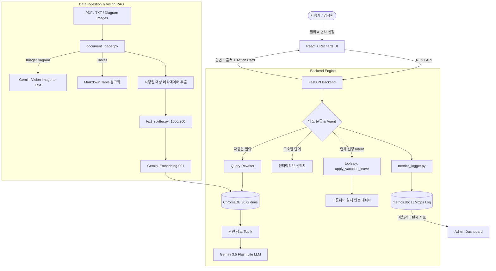

# 🏢 B2B 사내 지식 Q&A 및 업무 자동화 에이전트 (Enterprise Actionable RAG v2.0)

[](https://www.python.org/)
[](https://fastapi.tiangolo.com/)
[](https://ai.google.dev/)
[](https://www.langchain.com/)
[](https://react.dev/)
[](https://recharts.org/)
[](https://www.trychroma.com/)

> 사내 취업규칙, 복무규정, 보안지침 등의 문서를 기반으로 실무자의 질문에 정확한 답변과 근거 출처를 제공하며, **전자결재 자동 기안(Function Calling)**, **다이어그램/조직도 인식(Vision RAG)**, **LLMOps 비용/레이턴시 모니터링 대시보드**까지 지원하는 엔터프라이즈급 업무 자동화 에이전트 솔루션입니다.

---

## 🌟 주요 핵심 기능 (Key Features)

### 1. ⚡ 행동하는 에이전트 (Actionable Agent & Function Calling)
- 단순 규정 Q&A를 넘어 사용자가 *"나 다음 주 월요일부터 3일간 연차 쓸래"*라고 요청하면, 사내 규정 적합성을 검토한 후 **`apply_vacation_leave` 도구를 트리거**하여 그룹웨어 전자결재 시스템에 연차 기안서를 자동 임시저장(작성)합니다.
- 프론트엔드 채팅창에 문서번호, 결재선(팀장), 신청기간 등이 포함된 **인터랙티브 Action Card UI**를 렌더링합니다.

### 2. 🖼️ Vision RAG (멀티모달 이미지/다이어그램 분석)
- 사내 결재 프로세스 순서도, 조직도, 스캔 문서(PNG/JPG/PDF 내 이미지)를 **Multimodal LLM(Gemini Vision)**으로 분석하여 구조화된 마크다운 텍스트로 자동 전환 및 벡터 색인합니다.
- 다이어그램 질의 시 순서와 단계를 정확하게 인용하며 출처에 `[Vision RAG]` 뱃지를 표시합니다.

### 3. 📊 LLMOps 관제 대시보드 (비용 & 지연시간 모니터링)
- 질의 1건마다 발생하는 **입력/출력 토큰 수**, **예상 과금액(USD)**, **응답 지연시간(ms)**을 SQLite DB에 실시간 적재합니다.
- 프론트엔드 상단의 `[📊 LLMOps 대시보드]` 탭에서 **Recharts 기반 일별 API 호출 추이, 비용 그래프, 최근 감사 로그(Audit Log) 테이블**을 제공합니다.

### 4. 📑 복잡한 2차원 표(Table) 보존 및 정규화
- 취업규칙의 근속연수별 연차 일수 산정표, 징계 기준표 등 2차원 그리드 데이터가 붕괴되지 않도록 Markdown Table 표준 포맷으로 보존합니다.

### 5. 🔄 히스토리 기반 질의 재구성 (Query Rewriting)
- *"연차 규정 알려줘"* 후속으로 *"그럼 5년 차는 며칠이야?"*라고 물었을 때, 이전 대화 맥락을 복원하여 **"근속연수 5년 차 직원의 연차휴가 일수"**라는 독립적 검색어로 자동 재작성(Condense Question) 후 벡터 검색을 수행합니다.

### 6. 💡 능동적 되묻기(Clarification) & 메타데이터 자동 태깅
- 경조휴가 등 사유별로 조건이 분기되는 포괄적 질문에 대해 *"본인 결혼이신가요, 출산이신가요, 가족 사망이신가요?"*라고 능동적으로 되물으며 선택 버튼을 제시합니다.
- 문서 1페이지에서 `시행일자(2026-01-01)`, `적용대상(전 임직원)`, `담당부서(인사총무팀)`를 자동 추출하여 청크 메타데이터로 부여합니다.

---

## 🏗️ 시스템 아키텍처 (Architecture)



---

## 📁 디렉토리 구조 (Directory Structure)

```text
rag-poc/
├── backend/
│   ├── data/                         # 사내 규정 문서 및 테스트 다이어그램 이미지
│   │   ├── sample_취업규칙.txt
│   │   └── sample_결재라인_조직도.png
│   ├── metrics_logger.py             # SQLite 기반 토큰/비용/지연시간 로깅 모듈
│   ├── tools.py                      # 사내 전자결재 연동 도구 (Function Calling)
│   ├── document_loader.py            # Vision RAG + 표 정규화 + 메타데이터 추출 로더
│   ├── text_splitter.py              # 조항 및 표 경계 보호 청킹 모듈 (1000/200)
│   ├── vector_db.py                  # ChromaDB + Gemini 임베딩 관리 모듈
│   ├── rag_agent.py                  # Action Agent + 질의 재구성 + 되묻기 체인
│   ├── main.py                       # FastAPI 서버 & 대시보드 API 엔드포인트
│   ├── requirements.txt              # 백엔드 의존성 목록
│   └── .env.example                  # 환경변수 템플릿
│
└── frontend/
    ├── src/
    │   ├── App.js                    # 메인 챗봇 & 액션 카드 컴포넌트
    │   ├── App.css                   # 모던 B2B SaaS 테마 스타일시트
    │   ├── Dashboard.js              # Recharts 기반 LLMOps 관제 대시보드
    │   └── index.js                  # React 진입점
    └── package.json                  # 프론트엔드 의존성 (Recharts 등)
```

---

## 🚀 빠른 시작 가이드 (Quick Start)

### 1. 환경 설정 (.env)
`backend/.env.example`을 복사하여 `backend/.env`를 생성하고 본인의 API 키를 입력합니다:
```env
GOOGLE_API_KEY=your_gemini_api_key_here
GEMINI_API_KEY=your_gemini_api_key_here
CHAT_MODEL=gemini-3.5-flash-lite
EMBEDDING_MODEL=models/gemini-embedding-001
CHROMA_PERSIST_DIR=./chroma_db
DATA_DIR=./data
```

### 2. Backend 실행 (FastAPI)
```bash
cd backend
python -m venv venv
# Windows:
venv\Scripts\activate
# Mac/Linux:
# source venv/bin/activate

pip install -r requirements.txt
uvicorn main:app --reload --port 8000
```
- API 서버: `http://localhost:8000`
- Swagger 문서: `http://localhost:8000/docs`

### 3. Frontend 실행 (React)
```bash
cd frontend
npm install
npm start
```
- 브라우저 접속: `http://localhost:3000`

---

## 🧪 기능 테스트 시나리오

1. **전자결재 자동 기안 (Action Tool)**:
   - 입력: *"나 다음 주 월요일부터 3일간 연차 신청해줘"*
   - 결과: 규정 적합성 검토 후 `[✅ 전자결재 자동 기안 완료]` 액션 카드 생성 (문서번호 `GW-VAC-...` 발급)
2. **다이어그램 이미지 분석 (Vision RAG)**:
   - 입력: *"전자결재 휴가 승인 프로세스 순서가 어떻게 돼?"*
   - 결과: `sample_결재라인_조직도.png`를 기반으로 1단계(기안) -> 2단계(팀장) -> 3단계(인사팀) -> 4단계(완료) 순서도 답변
3. **대화 맥락 반영 연속 질의 (Query Rewriting)**:
   - 질문 1: *"연차 규정 알려줘"*
   - 질문 2: *"그럼 5년 차는 며칠이야?"*
   - 결과: `🔄 대화 맥락 반영 검색어: "5년 차 직원의 연차휴가 일수"`로 재구성 후 [표 1]에서 17일 산정표 정확 인용
4. **LLMOps 관리자 대시보드**:
   - 상단 `[📊 LLMOps 대시보드]` 탭 클릭 시 실시간 토큰 사용량, 과금액(USD), 응답 속도 그래프 확인
