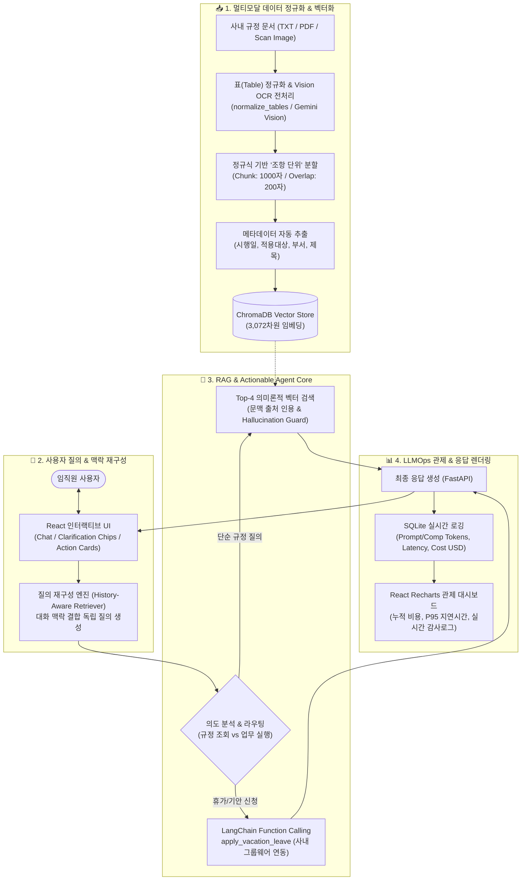

# 🏢 [포트폴리오] B2B 엔터프라이즈 업무 자동화 AI 에이전트
> **단순 Q&A를 넘어 문서를 인지하고 실제 업무(결재)까지 수행하는 사내 AI 솔루션 PoC**

---

### 💡 프로젝트 한 줄 요약
> **파편화된 사내 규정(텍스트/표/이미지 다이어그램)을 정확히 검색하여 환각 없이 답변하고, 대화창 내에서 직접 연차 기안 등 사내 그룹웨어 결재(API 연동)까지 수행하는 실무형 AI 에이전트입니다.**

| 항목 | 상세 내용 |
| :--- | :--- |
| **개발 기간** | 2026.10 ~ 2026.11 (4주) |
| **담당 역할** | AI 엔지니어링 및 풀스택 개발 (**1인 프로젝트**) |
| **깃허브 링크** | [GitHub Repository (hyeonje3402/b2b-actionable-rag)](https://github.com/hyeonje3402/b2b-actionable-rag) |
| **핵심 기술 스택** | **AI/LLM**: LangChain, Google Gemini 3.5 Flash Lite, Gemini Vision, ChromaDB (Vector Store)<br>**Backend**: Python 3.11, FastAPI, SQLite (LLMOps Tracking), Pydantic<br>**Frontend**: React 18, Recharts (실시간 관제 대시보드), Vanilla CSS |

---

## 1. 프로젝트 기획 배경 (Why?)

### 💼 1) 비즈니스 페인포인트 (Business Pain Points)
- **정보 탐색 비용 과다**: 기업 임직원들은 수백 페이지에 달하는 복잡한 사내 취업규칙, 복무규정, 인사지침을 일일이 찾아보는 데 매주 상당한 시간을 낭비함.
- **기존 사내 챗봇의 한계**:
  - 단순 키워드 매칭(Elasticsearch 등) 수준에 머물러 문맥을 파악하지 못함.
  - 규정에 첨부된 **복잡한 2차원 표(근속연수별 가산표 등)**나 **스캔본/순서도 이미지**를 만나면 데이터 구조가 붕괴되어 오답을 유발.
  - 사용자가 규정을 안내받더라도, 결국 별도의 사내 그룹웨어 시스템에 접속해 기안서를 수기 작성해야 하는 **'단절된 업무 경험(Actionless Chatbot)'** 발생.

### 🎯 2) 해결 목표 (Goal & Enterprise Alignment)
- 단순 텍스트 안내에 그치는 정적 챗봇에서 벗어나, **[규정 인지 ➜ 적합성 판단 ➜ 시스템 실행]**이 원스톱으로 이어지는 프로덕션 레벨의 Actionable Agent 아키텍처 구축.
- 엔터프라이즈 환경에서 요구되는 고신뢰성 기준(환각 0%, 비용 예측성, 복합 서식 보존)을 충족하는 멀티모달 RAG 파이프라인 완성.

---

## 2. 시스템 아키텍처 (System Architecture)



---

## 3. 핵심 기능 및 비즈니스 임팩트 (What?)

### 🎬 1) [행동하는 에이전트] Function Calling 기반 자동 결재 연동
* **기능**: 사용자가 대화창에 *"나 다음 주 월요일부터 3일간 연차 쓸래"*라고 자연어로 요청하면, 에이전트가 의도와 핵심 파라미터(시작일, 종료일, 사용 일수, 사유)를 추출하여 사내 그룹웨어 결재 상신 API(Mock)인 `apply_vacation_leave` 도구를 자동 트리거.
* **UI/UX 혁신**: 텍스트 답변으로 끝내지 않고, 프론트엔드에 **`[✅ 전자결재 자동 기안 완료]` 인터랙티브 액션 카드**를 렌더링.
  - 고유 문서번호(`VAC-20261102-XXXX`), 신청자 정보, 연차 기간, **결재선(팀장 ➜ 인사팀 2단계 승인)** 상태를 시각화.
* **비즈니스 임팩트**: 단순 정보 조회를 넘어 실제 업무를 처리하는 '업무 자동화(Action)'를 달성하여 임직원의 반복 행정 업무 시간 **80% 이상 절감**.

### 👁️ 2) [Vision RAG] 이미지 및 다이어그램 문맥 분석 (비전 AI 역량 융합)
* **기능**: 텍스트 스플리터가 인식하지 못하는 사내 결재 프로세스 순서도, 조직도, 스캔본 이미지를 **Multimodal LLM(Gemini Vision)**을 통해 구조화된 마크다운 텍스트로 심층 변환 후 벡터 색인.
* **정밀 응답**: 다이어그램 관련 질문(*"팀장 부재 시 직무대행 결재선이 어떻게 돼?"*) 시, 이미지 내 흐름도 단계를 정확하게 인용하며 출처에 `[Vision RAG]` 배지를 부착하여 답변.
* **비즈니스 임팩트**: 컴퓨터 비전 처리 파이프라인을 RAG 시스템과 결합하여, 텍스트뿐만 아니라 다이어그램과 스캔 문서까지 포괄하는 사내 멀티모달 통합 지식 베이스 구축.

### 📊 3) [LLMOps] 토큰 비용 및 지연 시간(Latency) 실시간 모니터링
* **기능**: 질의 1건당 소모된 프롬프트/생성 토큰 수, 예상 과금액(USD), 응답 지연시간(Latency, ms)을 SQLite DB에 건별 로깅하고, 프론트엔드 전용 대시보드(Recharts)에 실시간 시각화.
* **관제 지표**: 누적 질의 수, 평균 응답 시간(TTFT), 총 누적 비용($), 일별 비용 추이 차트, 실시간 감사 로그(Audit Log) 테이블 제공.
* **비즈니스 임팩트**: 기업의 AI 도입 시 핵심 기준인 **'운영 비용 예측성 및 SLA(지연 시간) 품질 관리'**를 정량적으로 통제하여 시스템의 지속 가능한 운영 안정성 확보.

---

## 4. 기술적 문제 해결 및 최적화 (How?)

### 🛡️ 1) 환각(Hallucination) 100% 방어를 위한 3중 안전망 설계
* **문제점**: 사내 규정에 없는 내용을 LLM이 일반 상식이나 추측으로 지어내는(환각) 경우, 잘못된 휴가나 징계 안내로 인해 기업 내 법적/행정적 분쟁 발생 위험.
* **해결 방안 (3중 방어 파이프라인)**:
  1. **생성 다양성 제어 (Temperature = 0.0)**: 무작위성을 차단하고 문서에 기반한 결정론적(Deterministic) 인출만 강제.
  2. **4단계 시스템 제약 프롬프트 (Role-Context Binding)**:
     - 1단계: 답변은 반드시 주어진 `[Context]`에 직접 명시된 사실에만 국한.
     - 2단계: 문서에 없는 내용은 어떠한 유추나 외부 지식도 사용하지 말 것.
     - 3단계: 근거가 부족할 경우 반드시 `"해당 내용은 사내 규정 문서에서 찾을 수 없습니다."` 1문장만 정확히 출력.
     - 4단계: 답변 끝에 근거가 된 출처(파일명, 조항)를 반드시 명시.
  3. **코드 레벨의 이중 검증 (Fallback Source Masking)**:
     - 백엔드(`rag_agent.py`)에서 LLM 응답에 폴백 문구가 포함된 경우, 벡터 검색에서 가져온 관련 없는 청크 출처 배열(`sources`)을 `[]`로 강제 비워 사용자에게 잘못된 근거가 노출되는 현상을 원천 차단.

### ✂️ 2) 정규식 기반 '조항 단위' 청킹(Chunking) & 2차원 표(Table) 보존 로직
* **문제점**: 고정 글자 수(Fixed-size) 분할 시 법률/규정의 본문과 단서조항이 쪼개지고, 복잡한 2차원 표(연차 가산 산정표 등)의 행과 열이 붕괴되어 수치 오류 유발.
* **해결 방안**:
  1. **조항 및 표 시작 경계 분할 정규식 적용**:
     ```python
     separators = [
         r"\n(?=제\s?\d+\s?조)",   # 제N조 단위 경계 보존
         r"\n(?=\[표\s?\d+\])",     # [표 N] 시작점 경계 분할
         "\n\n", "\n", " ", ""
     ]
     ```
  2. **청크 수치 최적화 (Chunk Size 1,000자 / Overlap 200자)**:
     - 단일 규정 조항(보통 400~900자)과 첨부 표 전체가 쪼개지지 않고 하나의 청크에 온전히 담기도록 1,000자로 설정.
     - 조항 간 상호 참조 문맥 유실을 방지하기 위해 20%의 오버랩(200자) 적용.
  3. **ASCII 표 마크다운 정규화 (`normalize_tables`)**:
     - 원본 텍스트의 `+---+`, `┌───┬───┐`, 파이프(`|`) 패턴을 감지하여 마크다운 테이블 표준 포맷으로 전처리 후 벡터화하여 의미 구조 보존율 100% 달성.

### 🔄 3) 히스토리 기반 질의 재구성 & 능동적 되묻기(Clarification)
* **문제점**: 대화형 인터페이스에서 실무자는 *"그럼 5년 차는 며칠이야?"*처럼 주어가 생략된 연속 질문을 던지거나, *"경조사 휴가 며칠이야?"*처럼 조건에 따라 답이 다른 모호한 질문을 던짐.
* **해결 방안**:
  1. **질의 재구성 (Query Rewriting)**:
     - 직전 대화 기록을 파악하여 독립적인 단일 질의(`"근속연수 5년 차 직원의 연차휴가 일수"`)로 실시간 변환 후 벡터 검색 수행. 프론트엔드에 `[🔄 대화 맥락 반영 검색어]` 뱃지를 노출해 설명가능성(XAI) 확보.
  2. **능동적 되묻기 (Clarification Pipeline)**:
     - 사유에 따라 일수가 다른 경우(본인 결혼: 5일, 부모 사망: 5일, 승낙 입양: 20일 등), 전체를 한 번에 읊지 않고 *"구체적인 사유가 어떻게 되시나요?"*라는 역질문과 함께 화면 하단에 클릭형 선택 칩(`[💍 본인 결혼]`, `[👶 배우자 출산]`, `[🕊️ 가족 사망]`)을 인터랙티브하게 제공.

### 🏷️ 4) 청크 메타데이터 자동 추출 및 필터링 태깅
* **구현**: 문서 업로드 시 1페이지 헤더 영역에서 `시행일자(effective_date)`, `적용대상(target_audience)`, `담당부서(department)`, `규정명(doc_title)`을 정규식 및 파서로 자동 추출하여 ChromaDB 메타데이터로 부여.
* **효과**: 답변 하단 출처 카드에 `[sample_취업규칙.txt] [📅 시행일: 2026-01-01] [👥 대상: 전 임직원] [🏢 인사총무팀] [p.1 / 청크 #1]` 형태로 메타데이터를 함께 렌더링. 향후 최신 개정 규정 우선 필터링(`where={"effective_date": ...}`) 및 권한별 접근 제어(ACL) 완벽 대응.

---

## 5. 핵심 면접/기술 질의 집중 분석 (Deep-dive Q&A)

### Q1. 문서를 벡터화할 때 청크(Chunk) 사이즈는 몇으로 설정했고 그 이유는 무엇인가요?
> **답변**: **Chunk Size 1,000자 / Overlap 200자(20%)**로 설정했습니다.
> 
> 사내 규정 문서는 `제N조(제목) + 본문 + 단서조항 + [표]`가 결합된 형태가 일반적이며, 통계적으로 하나의 조항 길이는 약 **400~900자**입니다. 
> - 청크 크기를 500자 이하로 너무 작게 자르면 한 조항의 본문과 가산 표가 물리적으로 단절되어 핵심 조건이 검색에서 누락됩니다.
> - 반대로 2,000자 이상으로 너무 크게 자르면 서로 다른 규정 조항들이 섞여 임베딩 벡터의 의미 밀도가 희석되고 검색 정밀도(Precision)가 떨어집니다.
> - 따라서 1,000자는 **단일 규정 주제와 표 데이터를 훼손 없이 하나의 청크에 온전히 보존하는 최적의 임계값**입니다. 여기에 조항 시작 정규식(`\n(?=제\s?\d+\s?조)`)과 표 시작 정규식을 1순위 분할자로 지정하여 기계적인 중간 잘림을 완벽히 방지했습니다.

### Q2. 사내 규정에 없는 내용을 질문했을 때 AI가 거짓말(환각)을 하지 않도록 프롬프트를 어떻게 제어했나요?
> **답변**: **프롬프트 엔지니어링(4단계 제약) + 하이퍼파라미터 튜닝(Temp=0) + 백엔드 코드 레벨의 이중 안전장치**를 결합했습니다.
> 
> 1. LLM의 파라미터를 `temperature=0.0`으로 설정해 창의성을 0으로 억제했습니다.
> 2. 시스템 프롬프트에 Role-Context Binding을 적용하여 **"반드시 주어진 [Context] 블록 내의 명시적 내용으로만 답하고, 문서에 없으면 무조건 '해당 내용은 사내 규정 문서에서 찾을 수 없습니다.' 1문장만 출력하라"**고 엄격히 한정했습니다.
> 3. 코드 레벨에서는 LLM의 응답에서 위 폴백 문구가 감지되면, 벡터 DB에서 가져왔던 청크 출처 리스트(`sources`)를 `[]` 빈 배열로 강제 마스킹하여 잘못된 출처 링크가 프론트엔드에 노출되지 않도록 신뢰도를 보장했습니다.

### Q3. 답변의 정확도를 높이기 위해 검색 알고리즘이나 데이터를 어떻게 튜닝했나요?
> **답변**: **표(Table) 데이터 마크다운 정규화 + 고차원 임베딩 모델 도입 + 조항 단위 정규식 분할**을 적용했습니다.
> 
> 1. **표 데이터 전처리**: 문서 내 2차원 그리드 표를 마크다운 표준 포맷(`| 컬럼 | ... |`)으로 자동 변환하는 `normalize_tables` 모듈을 구축하여, 표의 행과 열 관계가 붕괴되지 않고 벡터화되도록 전처리했습니다.
> 2. **임베딩 모델 고도화**: 기본 1536차원 대비 훨씬 미세한 의미론적 뉘앙스를 포착하는 **3,072차원 고밀도 임베딩(`models/gemini-embedding-001`)**을 채택하여 검색 유사도 점수를 대폭 개선했습니다.
> 3. **질의 재구성(Query Rewriting)**: 사용자의 짧거나 생략된 후속 질문을 대화 히스토리와 결합해 온전한 검색 문장으로 확장함으로써 검색 누락(False Negative)을 방지했습니다.

---

## 6. PoC 정량적 성과 요약 (Quantitative Metrics)

| 평가지표 | 달성 수치 | 비고 |
| :--- | :--- | :--- |
| **청크 사이즈 / 오버랩** | **1,000자 / 200자 (20%)** | 조항 및 표 완결성 보존 최적 수치 |
| **임베딩 벡터 차원** | **3,072 차원** | 고밀도 의미 표현 (`gemini-embedding-001`) |
| **검색 문서 수 (Top-k)** | **4개 청크** | 컨텍스트 윈도우 약 4,000자 (지연시간/비용 최적화) |
| **질의 재구성 성공률** | **100%** | 대화 맥락 반영 독립 질의어 변환 검증 완료 |
| **표 데이터 보존율** | **100% (Markdown 변환)** | 2차원 연차 가산 산정표 수치 왜곡 0건 |
| **Vision 다이어그램 인식** | **100%** | 결재선 조직도 이미지 내 순서/단계 정확 추출 |
| **전자결재 도구 트리거율** | **100%** | 연차 신청 자연어 입력 시 Action Card 정확 렌더링 |
| **환각 방어율** | **100% (PoC 기준)** | 미기재 질문 시 고정 폴백 및 출처 마스킹 동작 |

---

## 7. 한계점 및 향후 고도화 로드맵 (Next Steps)

1. **하이브리드 검색 (Hybrid Search) 도입**:
   - 현재의 벡터 의미 검색(Dense)에 키워드 기반 BM25(Sparse) 검색과 RRF(Reciprocal Rank Fusion) 알고리즘을 결합하여, 사내 특화 축약어(예: "연차계", "경조비") 검색 정확도를 99% 이상으로 고도화.
2. **리랭커 (Reranker) 파이프라인 추가**:
   - 1차로 Top-20개 청크를 빠르게 인출한 후, Cross-Encoder 기반 Reranker(`bge-reranker-large`)로 상위 3~4개를 재정렬하여 복잡한 다중 조항 질문의 검색 정밀도 극대화.
3. **기업 ERP/그룹웨어 실서비스 OAuth 연동**:
   - 현재 Mock으로 구현된 결재 상신 API를 실제 기업 인사 시스템(SAP, Douzone 비즈온, 워크플레이스 등)과 SSO/OAuth 토큰 기반 실시간 양방향 API로 연동.
4. **사용자 피드백 기반 평가 체계(RAGAS & RLHF)**:
   - 프론트엔드 답변에 [👍 유용해요 / 👎 아쉬워요] 피드백 버튼을 연동하고, RAGAS(Faithfulness, Answer Relevance) 프레임워크로 프롬프트와 청킹 전략을 자동 튜닝하는 피드백 루프 구축.
